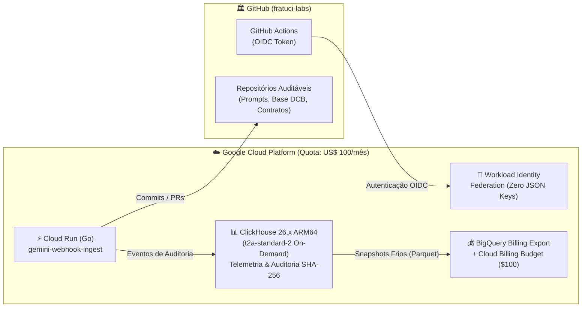

# ☁️ GCP Data Foundation — Arquitetura Enxuta, Real-Time Analytics & FinOps
**Líder Responsável:** 👤 **Anderson (`@fratuci`) — Arquiteto de Dados & Cloud**

> [!IMPORTANT]
> **Missão do Repositório:** Prover uma infraestrutura de dados e nuvem de classe empresarial no **Google Cloud Platform (GCP)** operando estritamente dentro da **cota mensal de US$ 100,00 (FinOps Quota)**, sem abrir mão de alta performance analítica, segurança Zero-Trust e rastreabilidade criptográfica das decisões de IA.

---

## 🏗️ 1. Visão Geral da Arquitetura Enxuta no GCP

Nossa arquitetura foi desenhada para eliminar custos ociosos (*scale-to-zero* onde possível) e extrair o máximo desempenho por dólar investido:

1. **Ingestão & Automação Serverless (`Cloud Run`):**
   - Hospeda o webhook `gemini-webhook-ingest` (desenvolvido em Go pelo **Antônio**) que converte os estudos e pareceres da **Adriana** e do **André** no Gemini em commits/PRs no GitHub.
   - Cobrança por milissegundo de CPU apenas durante a requisição (*Free Tier* cobre quase 100% da operação interna).
2. **Motor Analítico & Auditoria de IA (`ClickHouse 26.x em ARM64 t2a-standard-2`):**
   - Instância baseada em processadores **Ampere Altra ARM64 (`t2a-standard-2`)** sob demanda / agendada, aproveitando vetorização **SIMD ARM64** sobre colunas `LowCardinality` e índices invertidos nativos `TYPE text`.
   - Armazena cada inferência dos agentes de saúde e logística com **hash criptográfico SHA-256** do prompt aprovado pelo Jurídico (**André**) e da base farmacológica curada pela **Adriana**.
3. **Observabilidade Financeira (`BigQuery Billing Export`):**
   - Exportação contínua de custos detalhados do GCP para o BigQuery, alimentando alertas automáticos em **50%, 80%, 95% e 100%** da cota mensal de **US$ 100**.
4. **Segurança Sem Chaves Estáticas (`Workload Identity Federation`):**
   - **Proibição absoluta de chaves JSON (`service_account_key`)**. O GitHub Actions da organização `fratuci-labs` autentica no GCP via tokens OIDC efêmeros.

---

## 📂 2. Estrutura do Repositório

| Arquivo | Descrição | Responsável |
| :--- | :--- | :--- |
| [`infra/main.tf`](./infra/main.tf) | Infraestrutura como Código (Terraform) utilizando módulos oficiais `cloud-foundation-fabric`, Workload Identity Federation, Cloud Run e Budget Alert de US$ 100. | Anderson |
| [`schemas/clickhouse_healthtech_events.sql`](./schemas/clickhouse_healthtech_events.sql) | DDL ClickHouse 26.x otimizada para ARM64 com rastreabilidade criptográfica de interações medicamentosas e telemetria de LLMs. | Anderson & Antônio |
| [`docs/finops-policy.md`](./docs/finops-policy.md) | Política corporativa de FinOps detalhando a alocação da cota de US$ 100/mês entre Engenharia de Dados, IA, Jurídico e HealthTech. | Anderson (c/ acordo de todos os sócios) |

---

## 🔐 3. Garantias de Conformidade Interdisciplinar

- **Para a Diretoria Jurídica (André):** Toda resposta gerada pelo agente de IA grava no ClickHouse o `prompt_sha256`, o `legal_approval_id` e o flag `human_review_required`, atendendo ao Art. 20 da LGPD.
- **Para a Diretoria de Farmácia & Negócios (Adriana):** As consultas de interações medicamentosas referenciam a versão exata do dicionário DCB/DCI (`pharma_dataset_version`), permitindo auditoria sanitária retroativa conforme o `POP-001`.
- **Para a Engenharia de IA (Antônio):** Contabilização em tempo real de tokens de entrada/saída e custo estimado em USD por chamada Vertex AI / Gemini.
